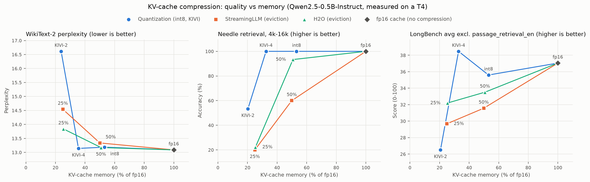

# kvshrink: KV-cache compression for long-context LLM serving

A from-scratch study of KV-cache compression on **Qwen2.5-0.5B-Instruct** on a single **NVIDIA T4**.
Quantization (int8, KIVI-style 2/4-bit, mixed K/V precision) and token eviction (StreamingLLM, H2O)
are evaluated at matched memory on perplexity, needle-in-a-haystack retrieval, a LongBench subset,
and how many concurrent requests fit on the GPU.

Everything below the model weights is implemented here: the KV cache, the Qwen2 forward pass
(RoPE, grouped-query attention, causal masking), the quantizers with bit packing, the eviction
policies, the evaluations and the statistics. Hugging Face `transformers` is used only to load
weights and, in tests, as the reference the custom forward pass must match token for token.



## Findings

1. **4-bit KIVI-style quantization is lossless within measurement precision**, at about 3x less KV
   memory: no detectable change in perplexity, needle retrieval or LongBench (paired CIs include 0).
2. **Keys are much more fragile than values.** At the same memory, 4-bit keys with 2-bit values
   (K4-V2) stay lossless on retrieval, while 2-bit keys with 4-bit values lose clearly. K4-V2 is the
   best quality-per-byte point in the study.
3. **Per-channel key quantization is essential for this model.** With per-token key groups the model
   breaks even at 4 bits. Key statistics show why: some layers carry extreme outlier channels, and in
   several of them (layers 0-2 and 8) the `k_proj` bias explains almost all of the outlier.
4. **Perplexity hides what eviction loses.** H2O and StreamingLLM look competitive on WikiText-2
   perplexity, but fail needle retrieval as soon as the needle leaves the kept set. At about 4x
   compression, 2-bit quantization retrieves far better than either eviction method; on the LongBench
   subset the three are statistically indistinguishable with 30 samples per task.
5. **Layer sensitivity measured by perplexity does not transfer to retrieval.** Putting the 12 layers
   that tolerate 2 bits best (by perplexity) at 2 bits ties K4-V2 on held-out perplexity but loses
   significantly on the needle test at the same memory.
6. **Memory capacity is not throughput.** Compression multiplies how many sequences fit on the GPU,
   but this implementation dequantizes the cache in PyTorch every step, so aggregate decode
   throughput of the quantized caches drops far below fp16. Turning capacity into throughput needs a
   fused dequantize-attention kernel, which is out of scope here. Eviction keeps throughput high.

Every number is in the generated tables below; nothing in them is typed by hand.

## Results

<!-- BEGIN RESULTS -->
_Generated by `python scripts/build_readme.py` from `results/*.json`; do not edit by hand._

### Baseline (fp16 cache, batch 1)

KV cache: **12288 bytes/token** measured with `torch.cuda.memory_allocated` (analytic: 12288). Weights: 950 MiB.

| context | prefill tok/s | decode tok/s |
|---:|---:|---:|
| 512 | 17748 | 43.2 |
| 2048 | 19981 | 43.3 |
| 4096 | 17660 | 42.9 |
| 8192 | 14143 | 43.5 |

### Main comparison (Qwen2.5-0.5B-Instruct, T4)

Compression = fp16 KV bytes / method KV bytes, measured on the needle runs (4k-16k mean; includes scales, zero points, fp16 windows, H2O scores). Paired deltas vs fp16 in points with 95% paired-bootstrap CI; `*` = CI excludes 0. LongBench average excludes passage_retrieval_en (fp16 itself scores near chance).

| method | compression | WikiText-2 PPL (delta) | needle acc 4k-16k | needle delta | LongBench avg | LongBench delta | max concurrent @8k (vs fp16) |
|---|---:|---:|---:|---:|---:|---:|---:|
| fp16 (no compression) | 1.00x | 13.09 (+0.00) | 100% | - | 37.0 | - | 142 (1.00x) |
| int8 per-token | 1.88x | 13.19 (+0.10) | 100% | +0.0 [+0.0, +0.0] | 35.6 | -1.4 [-6.2, +3.6] | 242 (1.70x) |
| KIVI 4-bit | 3.07x | 13.14 (+0.05) | 100% | +0.0 [+0.0, +0.0] | 38.5 | +1.4 [-2.5, +5.6] | 376 (2.65x) |
| KIVI 2-bit | 4.93x | 16.61 (+3.52) | 53% | -46.7 [-60.0, -31.1]* | 26.5 | -10.5 [-18.5, -3.1]* | 561 (3.95x) |
| StreamingLLM, 50% budget | 2.00x | 13.34 (+0.25) | 60% | -40.0 [-55.6, -26.7]* | 31.6 | -5.5 [-12.2, +1.8] | 264 (1.86x) |
| StreamingLLM, 25% budget | 4.01x | 14.54 (+1.45) | 20% | -80.0 [-91.1, -68.9]* | 29.7 | -7.4 [-15.7, +1.0] | 528 (3.72x) |
| H2O, 50% budget | 1.97x | 13.17 (+0.08) | 93% | -6.7 [-15.6, +0.0] | 33.5 | -3.5 [-10.3, +3.4] | 255 (1.80x) |
| H2O, 25% budget | 3.94x | 13.84 (+0.75) | 22% | -77.8 [-91.1, -66.7]* | 32.2 | -4.9 [-11.6, +2.2] | 511 (3.60x) |

### Ablations around KIVI-2 (WikiText-2 test PPL; needle at 8k, 30 paired samples)

One factor changed at a time: fp16 window (r), group size (g), key/value bit split, per-token vs per-channel keys.

| variant | spec | KV bytes/token | PPL (delta) | needle acc @8k | needle delta |
|---|---|---:|---:|---:|---:|
| kivi2 | type=kivi, bits=2, group_size=32, residual=128 | 2928 | 16.61 (+3.52) | 63% | -36.7 [-53.3, -20.0]* |
| kivi2_r0 | type=kivi, bits=2, group_size=32, residual=0 | 2304 | 17.92 (+4.83) | 60% | -40.0 [-56.7, -23.3]* |
| kivi2_r32 | type=kivi, bits=2, group_size=32, residual=32 | 2460 | 17.04 (+3.95) | 63% | -36.7 [-53.3, -20.0]* |
| kivi2_r512 | type=kivi, bits=2, group_size=32, residual=512 | 4800 | 15.48 (+2.39) | 67% | -33.3 [-50.0, -16.7]* |
| kivi2_g16 | type=kivi, bits=2, group_size=16, residual=128 | 3648 | 14.79 (+1.70) | 93% | -6.7 [-16.7, +0.0] |
| kivi2_g64 | type=kivi, bits=2, group_size=64, residual=128 | 2568 | 19.67 (+6.58) | 23% | -76.7 [-90.0, -60.0]* |
| k4v2 | type=quant, key_bits=4, value_bits=2, key_mode=channel, value_mode=token, key_group=32, value_group=32, residual=128 | 3648 | 13.47 (+0.38) | 100% | +0.0 [+0.0, +0.0] |
| k2v4 | type=quant, key_bits=2, value_bits=4, key_mode=channel, value_mode=token, key_group=32, value_group=32, residual=128 | 3648 | 15.97 (+2.88) | 73% | -26.7 [-43.3, -10.0]* |
| q2_tokenkeys | type=quant, key_bits=2, value_bits=2, key_mode=token, value_mode=token, key_group=32, value_group=32, residual=128 | 2928 | 326.21 (+313.12) | 0% | -100.0 [-100.0, -100.0]* |
| kivi4 | type=kivi, bits=4, group_size=32, residual=128 | 4368 | 13.14 (+0.05) | 100% | +0.0 [+0.0, +0.0] |
| q4_tokenkeys | type=quant, key_bits=4, value_bits=4, key_mode=token, value_mode=token, key_group=32, value_group=32, residual=128 | 4368 | 25.38 (+12.29) | 0% | -100.0 [-100.0, -100.0]* |

### Per-layer sensitivity (one layer at 2-bit, rest KIVI-4; WikiText-2 test PPL delta vs all-KIVI-4)

- Most sensitive: 9 (+0.301), 16 (+0.286), 11 (+0.196), 10 (+0.143)
- Least sensitive: 1 (-0.004), 0 (+0.008), 17 (+0.015), 2 (+0.015)
- Sum over the 12 least sensitive layers: +0.326; over the other 12: +1.583
- Spearman correlation between a layer's 2-bit per-channel key error and its sensitivity: 0.39
- Mean relative key quantization error, per-token vs per-channel grouping: 0.097 vs 0.034 (4-bit), 0.488 vs 0.169 (2-bit)
- Largest key outlier ratio (max / median channel-pair magnitude): 94.1 (layer 8); see results/key_stats_0.5b.md

### Held-out check: layer-wise mixed precision vs K4-V2 at equal memory

Layers for `mixed12` were chosen from the WikiText-2 *test* sensitivity sweep, so it is evaluated on the *validation* split and on the needle test.

| variant | spec | KV bytes/token | PPL (delta) | needle acc @8k | needle delta |
|---|---|---:|---:|---:|---:|
| kivi4 | type=kivi, bits=4, group_size=32, residual=128 | 4368 | 12.11 (+0.03) | 100% | +0.0 [+0.0, +0.0] |
| kivi2 | type=kivi, bits=2, group_size=32, residual=128 | 2928 | 14.45 (+2.38) | 63% | -36.7 [-53.3, -20.0]* |
| k4v2 | type=quant, key_bits=4, value_bits=2, key_mode=channel, value_mode=token, key_group=32, value_group=32, residual=128 | 3648 | 12.41 (+0.33) | 100% | +0.0 [+0.0, +0.0] |
| mixed12 | type=kivi, bits=4, group_size=32, residual=128, 2-bit layers=[0, 1, 2, 5, 6, 12, 13, 14, 17, 18, 19, 23] | 3648 | 12.39 (+0.31) | 80% | -20.0 [-33.3, -6.7]* |

### Capacity: concurrent sequences on one T4

Measured = largest batch that decodes without OOM (cache synthetically filled to the context length). Ideal = ANALYTIC (free memory after weights / KV bytes per sequence), i.e. what a fused low-bit attention kernel could approach. Throughput is aggregate decode tokens/s at the measured max batch.

| method | context | measured max batch (vs fp16) | ideal max batch (analytic) | decode tok/s at max batch |
|---|---:|---:|---:|---:|
| full | 4096 | 284 (1.00x) | 280 | 3453 |
| full | 8192 | 142 (1.00x) | 140 | 1767 |
| int8 | 4096 | 488 (1.72x) | 527 | 220 |
| int8 | 8192 | 242 (1.70x) | 263 | 111 |
| kivi4 | 4096 | 712 (2.51x) | 839 | 197 |
| kivi4 | 8192 | 376 (2.65x) | 433 | 100 |
| k4v2 | 4096 | 848 (2.99x) | 1024 | 193 |
| k4v2 | 8192 | 448 (3.15x) | 535 | 96 |
| kivi2 | 4096 | 1056 (3.72x) | 1316 | 187 |
| kivi2 | 8192 | 561 (3.95x) | 699 | 92 |
| stream50 | 4096 | 528 (1.86x) | 560 | 1214 |
| stream50 | 8192 | 264 (1.86x) | 280 | 626 |
| stream25 | 4096 | 1048 (3.69x) | 1120 | 2240 |
| stream25 | 8192 | 528 (3.72x) | 560 | 1189 |
| h2o50 | 4096 | 511 (1.80x) | 551 | 666 |
| h2o50 | 8192 | 255 (1.80x) | 275 | 337 |
| h2o25 | 4096 | 1019 (3.59x) | 1103 | 1230 |
| h2o25 | 8192 | 511 (3.60x) | 551 | 664 |
<!-- END RESULTS -->

## What this means for serving (servemesh)

[servemesh](https://github.com/pandeylakshya207-max/servemesh) is a cache-aware Go gateway that
routes requests to llama.cpp replicas. These results change how it should reason about replicas
(design implications only; not implemented or measured in servemesh):

- **Admission and capacity should count KV bytes, not requests.** A replica's capacity is
  `(GPU memory - weights) / (context tokens x KV bytes per token)`, and bytes per token depends on
  its cache configuration (see the capacity table). A router that counts requests per replica
  will either under-fill compressed replicas or overload fp16 ones.
- **Route by workload, not only by load.** Retrieval-heavy traffic (RAG, long-document QA) should go
  to quantized-cache replicas; eviction replicas are fine for chat-style traffic that mostly needs
  recent context, and keep higher throughput.
- **Protect keys first.** llama.cpp sets key and value cache types separately
  (`--cache-type-k`, `--cache-type-v`; quantized V requires flash attention, `-fa`). The K/V
  asymmetry measured here argues for keeping keys at higher precision than values.
- **Compression helps prefix caching.** Smaller per-token state lets more shared prefixes stay
  resident per replica, which raises the hit rate of cache-aware routing.

## Limitations

- One small model (0.5B) on one GPU type. The planned 1.5B scaling check has not been run yet.
- Small evaluation sets: 30 examples per LongBench task, 15-30 needle prompts per setting.
  Differences inside the reported CIs are not claims.
- The LongBench prompt templates follow LongBench's format but should be checked against the
  official `dataset2prompt.json`. `passage_retrieval_en` is at chance even for fp16 at 7.5k tokens
  and is excluded from the averages (reported separately).
- Capacity runs fill caches with synthetic contents; memory and compute do not depend on values,
  but no real traffic was replayed. "Ideal" capacity is analytic, not measured.
- Attention is not fused with dequantization, so quantized-cache throughput here is a lower bound.
- StreamingLLM keeps original RoPE positions (no re-indexing inside the cache); valid because all
  contexts stay within the model's 32k window. H2O accumulates attention including prefill.
- Perplexity uses the instruct model on WikiText-2, so absolute values are not comparable to papers
  that use base models; only differences between caches are meaningful.

## Reproduce

Python 3.12, `pip install -r requirements.txt` (plus PyTorch). Correctness tests run on CPU; every
experiment ran on a free Colab T4 (torch 2.11, transformers 5.22.1).

```bash
pip install -e . --no-deps
python -m pytest -q                                   # unit tests (CPU)
KVSHRINK_SLOW=1 python -m pytest -q                   # + token-for-token match with HF on the real model
python scripts/bench_baseline.py --config configs/baseline.yaml       # results/baseline.*
python scripts/eval_ppl.py --config configs/ppl.yaml                  # results/ppl_0.5b.*
python scripts/eval_needle.py --config configs/needle.yaml            # results/needle_0.5b.*
python scripts/eval_longbench.py --config configs/longbench.yaml      # results/longbench_0.5b.*
python scripts/analyze_paired.py                                      # results/paired_0.5b.*
python scripts/eval_ppl.py --config configs/ablation_ppl.yaml         # results/ablation_ppl_0.5b.*
python scripts/eval_needle.py --config configs/ablation_needle.yaml   # results/ablation_needle_0.5b.*
python scripts/analyze_paired.py --needle results/ablation_needle_0.5b.json --output results/paired_ablation_0.5b
python scripts/key_stats.py                                           # results/key_stats_0.5b.*
python scripts/make_layer_config.py && python scripts/eval_ppl.py --config configs/layer_sensitivity.yaml
python scripts/make_mixed_config.py
python scripts/eval_ppl.py --config configs/mixed_ppl.yaml            # results/mixed_ppl_val_0.5b.*
python scripts/eval_needle.py --config configs/mixed_needle.yaml      # results/mixed_needle_0.5b.*
python scripts/analyze_paired.py --needle results/mixed_needle_0.5b.json --output results/paired_mixed_0.5b
python scripts/bench_capacity.py --config configs/capacity.yaml       # results/capacity_0.5b.*
python scripts/plot_frontier.py                                       # results/frontier_0.5b.{png,svg,csv}
python scripts/build_readme.py                                        # regenerates the tables above
```

## Layout

```
src/kvshrink/   cache.py (fp16 cache), quant.py (quantizer + packing), quant_cache.py (int8/KIVI/mixed),
                evict_cache.py (StreamingLLM, H2O), model.py (Qwen2 forward), factory.py, capacity.py,
                needle.py, longbench.py, stats.py
tests/          unit tests, including token-for-token equivalence with Hugging Face
scripts/        every experiment, analysis, figure and the README table generator
configs/        all experiment settings (YAML)
results/        raw JSON + generated Markdown for every run
```

## References

- KIVI: Liu et al., 2024. *KIVI: A Tuning-Free Asymmetric 2bit Quantization for KV Cache.*
- H2O: Zhang et al., 2023. *H2O: Heavy-Hitter Oracle for Efficient Generative Inference of LLMs.*
- StreamingLLM: Xiao et al., 2023. *Efficient Streaming Language Models with Attention Sinks.*
- LongBench: Bai et al., 2023. *LongBench: A Bilingual, Multitask Benchmark for Long Context Understanding.*
